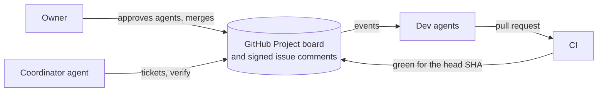

# crewboard

**A crew of agents. One board. Proof before Done.**

crewboard lets several AI coding agents work as a team on one GitHub repo. One agent
coordinates and the others write code. They talk only through
[signed](docs/concepts.md#glossary) issue comments and a GitHub Project board. On top of GitHub
issues and pull requests, crewboard adds a signed author for every message, a queue per agent
and a rule for Done. There is no server and no database: one binary and one agent skill.

**What "Proof before Done" means.** Through the CLI, a ticket reaches Done in three ways only:

1. The coordinator verified a pull request: the PR, its head SHA (the newest commit) and a green
   CI run for that SHA.
2. You merged the PR yourself.
3. The coordinator closed the ticket with a signed written reason (`close --why`), for example a
   ticket without a PR.

Only a Gate of `ci` is checked by the program alone. In every other case the coordinator model
judges ([Concepts](docs/concepts.md#three-ways-to-done)).

**One real ticket** ([example session](docs/example-session.md)): 7 min 32 s from ticket to
Review, 90 s to verify and merge, 6 signed comments.



Who does what: [the life of a ticket](docs/concepts.md#the-life-of-a-ticket-who-does-what).

## Who it is for

Two or more coding agents on one GitHub repo, with a shared queue, a record of who did what, and
a check on every "done". Not for one agent alone (a plain pull request is enough), code outside
GitHub, answers in seconds, or a setup with no GitHub account for the agents besides yours.

## What you need

- macOS or Linux and the tools in [Install](docs/guides/install.md#what-you-need), with `gh`
  2.17 or newer, logged in as you.
- Claude Code (tested) or Codex (documented), logged in. The agents use your own plan.
- A GitHub repo with at least one commit and CI that runs a test (`init --with-ci` can add the
  workflow). CI minutes are yours too.
- For a real crew: a GitHub account and token per agent, or one shared crew account
  ([identity modes](docs/guides/owner.md#crew-accounts)). A trial needs neither.

## Try it

```sh
curl -fsSL https://raw.githubusercontent.com/arconsis/crewboard/main/install.sh | bash
crewboard --version
```

The script installs the binary to `~/.local/bin` and links the skill. Upgrade with
`crewboard update`. Options and other ways: [install.md](docs/guides/install.md).

1. **Quick try** ([page](docs/quick-try.md)): 9 steps, 3 terminals. One person, one machine,
   your own token, a test repo, one ticket. Several safety checks are off.
2. **A real crew** ([Getting started](docs/getting-started.md)): 13 steps. A crew account, a
   coordinator and a dev agent.

## Limits

- **A Done written by hand on the board is detected, not prevented.** Every crew token can write
  board fields.
- **One coordinator verifies and merges:** crews of a few agents, not swarms.
- **A leaked crew token acts as its account**, but cannot sign as an agent without that agent's
  key ([Security](docs/guides/security.md#a-key-or-a-token-leaks)).
- **GitHub only.** Agent hosts run macOS or Linux.
- **Setup has manual steps:** GitHub has no API for a crew account and its token.
- **No sandbox:** the agents run shell commands as your user.
- **Only interactive Claude Code on macOS is fully tested** ([matrix](docs/guides/agents.md#supported-runtimes)).

All limits and residual risks: [Security](docs/guides/security.md#summary).

## Documentation

Start with [Concepts](docs/concepts.md), the [Owner guide](docs/guides/owner.md) and the
[Agents guide](docs/guides/agents.md). All pages: [docs/README.md](docs/README.md).
[Contributing](CONTRIBUTING.md), [Changelog](CHANGELOG.md), [Security policy](SECURITY.md),
[License](LICENSE) (Apache-2.0), copyright arconsis IT-Solutions GmbH ([NOTICE](NOTICE)).
