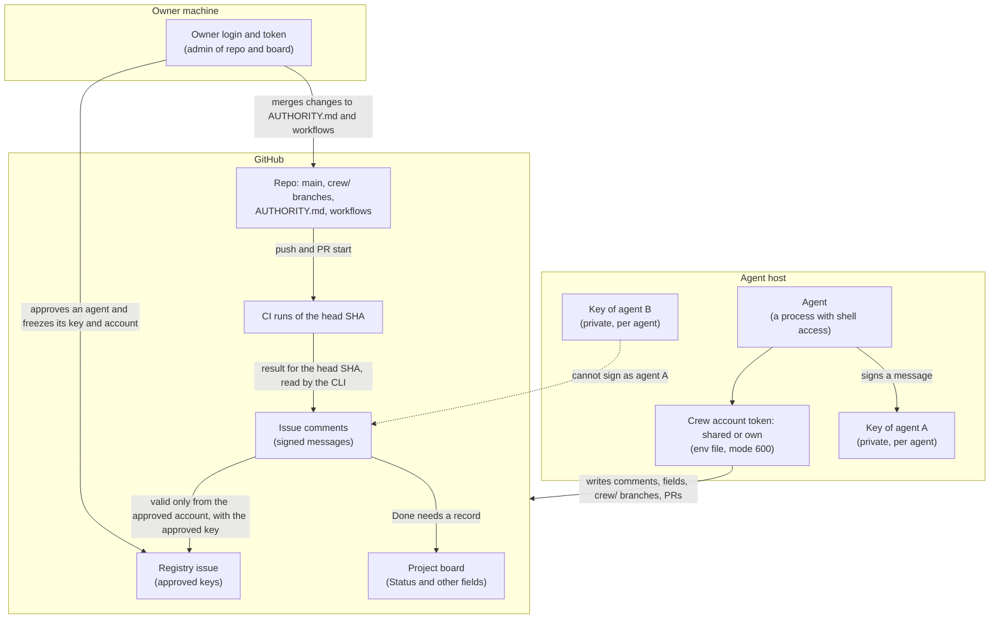

# Security

Read this if you must decide whether to trust crewboard with an initiative. It says what
crewboard protects, how you check it, and what it does not protect.

## Summary

**Threats that crewboard handles:** forged, edited and replayed messages, unknown senders,
strangers, stolen agent keys, an agent that acts as the owner, secrets in comments, a token sent
to the wrong host, a model that merges a protected change, and ticket text that widens a scope.
[Threats](#threats-that-crewboard-handles) lists each one with its defence.

**What crewboard guarantees.**

- Agents talk only through GitHub comments. A message counts only if its GitHub author is the
  account that the owner approved for the sender and its Ed25519 signature matches the approved
  key of the sender. Any other comment is data, never an instruction.
- The owner approves each agent, its key and its GitHub account by hand. The owner's own
  comments need no signature.
- On a crew board (a shared crew account or one own account per agent), every agent command
  refuses the owner's token, and `start` refuses a token or a plain `gh` of another account than
  the approved one. Only the board key `insecure_one_account` makes a trial without that check.
- A PR that changes a protected path (seven built-in paths, and the globs of `protected_paths`)
  is merged by the owner only, by the crewboard CLI. `git` and `gh` skip that check. With the
  branch rule that `init` sets, they need a pull request and your review too.
- Through the CLI a ticket reaches Done only with evidence (a PR, its head SHA and a green CI run for that SHA), with the owner's own merge, or with a signed written reason of the coordinator ([Concepts](../concepts.md#three-ways-to-done)). A Done written by hand on the board is detected, not prevented (next list).
- crewboard never stores or prints a token. It sends the token only to the GitHub API.

**What crewboard does not guarantee.**

- It does not stop an agent that holds the owner's token on purpose.
- It does not prevent a board field from being written. The holder of any crew token can set
  `Status = Done` on any ticket. crewboard detects it: `status`, `audit` and the coordinator's
  watch cycle flag a Status that the signed log does not support ([Concepts](../concepts.md#done-without-proof-is-detected)).
- It does not stop a compromised host, or a person who steals a crew token or a private key.
- It does not choose who may join. Any account that may comment on the registry issue can ask;
  `init` locks the issue to collaborators, and you approve each account by hand.
- It does not make an agent write correct code. Your Gate, your CI and the owner's review do that.
  A workflow that tests nothing still gives a green run: the Gate is as strong as your tests.
- A no-model coordinator is limited by its OS user and token, not by a config key.

**Residual risks.** [Residual risks](#residual-risks) lists them. The main ones are a leaked crew token (a crew account
can reach every repo that you gave it), an owner token in an agent shell, a compromised agent host, and an approved agent that does bad
work (a valid signature proves who wrote a message, not that the message is right). [A key or a token leaks](#a-key-or-a-token-leaks) says what to do after a leak.

Each statement below names the section of the [specification](../design/spec/README.md) or the
source file that implements it. The text describes the code on `main`. The detail is in
[Security details](../design/spec/security-details.md):

- [What is signed, and how a reader checks it](../design/spec/security-details.md#what-is-signed-and-how-a-reader-checks-it)
- [How crewboard sorts owner, foreign and unknown comments](../design/spec/security-details.md#owner-comments-foreign-comments-and-unknown-comments)
- [Edited owner comments](../design/spec/security-details.md#edited-owner-comments)
- [Token handling](../design/spec/security-details.md#token-handling): the token order, the env file, the private key, the API base and the secret scan
- [`selftest`, `audit` and `status`](../design/spec/security-details.md#selftest-audit-and-status)
- [Trust roots](../design/spec/security-details.md#trust-roots): the owner login, the approved keys and the registry

## Threats that crewboard handles

| Threat | What crewboard does | Where |
| --- | --- | --- |
| A forged message: someone writes a comment that claims to come from an agent. | The signature does not match the key of that agent. `watch` does not deliver the comment. It reports a security event `bad-signature`. | [Signature](../design/spec/messages.md#signature); [events.rs](../../src/events.rs) |
| An edited message: someone changes the text of a valid message later. | The body hash is part of the signed data, so the signature fails. Also, any comment whose `updated_at` differs from `created_at` is refused as `edited-message`, even if the body still verifies. | [canonical.rs](../../src/protocol/canonical.rs); [events.rs](../../src/events.rs) (`classify_message`) |
| An edited owner comment: the holder of any crew token, who can edit comments of other users, rewrites an owner answer or `/crew reject`. | An owner comment counts only if it was never edited, or if the owner made every edit. Any other edit makes it untrusted: it is not delivered, and a security event `edited-message` names the editor. | [Edited owner comments](../design/spec/security-details.md#edited-owner-comments); [comments.rs](../../src/comments.rs) |
| A replayed message: a valid message is copied to another issue. | The issue (`owner/repo#number`) is part of the signed data. The copy fails the check. | [canonical.rs](../../src/protocol/canonical.rs) |
| A replayed message in the same issue: the holder of any crew token posts a copy of an old valid message again. | The signed `ts` must be at most 15 minutes before and at most 5 minutes after the GitHub `created_at`, so an old copy is refused. A copy inside the window repeats a sender and signature that the issue already shows, so it is refused too. Both cases are the event `replayed-message`. Limit: a holder who deletes the original and posts the copy within 15 minutes gets it accepted once ([residual risks](#residual-risks)). | [replay.rs](../../src/protocol/replay.rs); [comments.rs](../../src/comments.rs) (`check_ts`) |
| An unknown sender: a crew header with a name that nobody approved. | Refused as `unknown-sender`. | [events.rs](../../src/events.rs); [registry.rs](../../src/registry.rs) |
| A stranger who posts on a ticket: any other GitHub user. | The comment is "foreign". It is dropped and counted. If it wears a crew header, it is a security event `foreign-author`. | [Untrusted input](../design/spec/messages.md#untrusted-input); [events.rs](../../src/events.rs) (`is_foreign`) |
| One agent's account posts a message signed by another agent (a shared host, a copied comment). | The approval binds each agent to one GitHub account. A signed message of another account than the sender's is not delivered; it is the security event `foreign-author`, which names both accounts. | [Signature](../design/spec/messages.md#signature); [events.rs](../../src/events.rs) (`classify`) |
| A stranger who asks to join. | A join request counts from any account, but nothing happens until the owner approves it. `approve` shows the account; `init` locks the registry issue to collaborators. | [Registry issue](../design/spec/board.md#registry-issue); [registry.rs](../../src/registry.rs) |
| A stolen agent key. | The key alone is not enough: the comment must also come from the account that the owner approved for that agent. The owner can reject the agent. See [leaks](#a-key-or-a-token-leaks) for the limits. | [events.rs](../../src/events.rs); [registry.rs](../../src/registry.rs) |
| An agent that runs as the owner: it posts with the owner's token and so looks like the owner. | On every crew board (with a shared `crew_login` or with own accounts; only the trial board key `insecure_one_account` differs), every agent command refuses the owner's token (`agent-uses-owner-token`), also with `--insecure-one-account`, and `approve` refuses a join of the owner's account (`approve-owner-account`). `selftest` refuses a token (`agent-token-not-crew`) and a plain `gh` in the agent shell (`agent-gh-not-crew`) of another account than the approved one. This stops mistakes, not an agent that holds the owner's token on purpose ([residual risks](#residual-risks)). | [Phases](../design/spec/identity.md#phases); [agent_gh.rs](../../src/agent_gh.rs) |
| A secret in a message: an agent pastes a token in a comment. | Every signed post scans the body and refuses to post. The scan is a pattern list ([secret scan](../design/spec/security-details.md#token-handling)). | [secrets.rs](../../src/secrets.rs); [ops/say.rs](../../src/ops/say.rs) |
| A token sent to the wrong host. | The API base is fixed, and crewboard follows only URLs under it ([API base rule](../design/spec/security-details.md#token-handling)). | [github/mod.rs](../../src/github/mod.rs) |
| A no-model coordinator model that tries to leave its scope: it removes the `headless` key or passes `--config-dir` to another dir. | Not stopped by crewboard. The key is a guardrail against mistakes and prompt drift, not a boundary ([residual risks](#residual-risks)). | [No-model coordinator](../design/spec/agents.md#headless-coordinator) |
| A crew PR that edits a protected path (`AUTHORITY.md`, `.crewboard.toml`, a CODEOWNERS file, a workflow or an action), and a coordinator model that merges it. | The crewboard CLI lets only the owner merge such a PR, whatever the keys say. `git` and `gh` run no crewboard code: the branch rule that `init` sets covers them. `verify`, `close --verified` and `merge` (so also `tick`) refuse it with `protected-path-owner-merge`. The seven built-in paths and the `protected_paths` globs: [Protected paths](owner.md#protected-paths). A rename out of such a path counts; a list of more than 1000 files and a list that cannot be read are refused (fail closed), also by `done`. `verify --fail` stays allowed. | [Authority](../design/spec/board.md#authority); [rules/protected.rs](../../src/rules/protected.rs) |
| The holder of any crew token edits the issue body to turn a Gate into "CI green" or to add `CI: none` after the assignment. | The headless "CI only" judgement reads the signed `gate:` line of the assignment, not the body; no signed line means "not CI only". `assign` also signs `ci: none` or `ci: required`; `done`, `verify` and `merge` read that line, so a body edit cannot add or remove `CI: none`. The one remaining hole: a ticket assigned before the signed `ci:` line existed falls back to the live body. | [Ticket content](../design/spec/tickets.md#ticket-content); [headless.rs](../../src/headless.rs) |
| The holder of any crew token writes the board `State` of an agent (`left`, `draining`) to mute it or to make the coordinator take its tickets. | The `State` is a mirror. The registry log decides who may act and who stops: the owner's `/crew stop` and `/crew reject`, the agent's signed stopping notice and `lifecycle: left` marker. The agent stays trusted and keeps its tickets. `status` shows a `trust problem` line, `audit` a `field-mismatch`, and the coordinator posts one signed `info` to the owner. | [Fields](../design/spec/board.md#fields); [registry.rs](../../src/registry.rs) (`build_trust`); [ops/duties.rs](../../src/ops/duties.rs) |
| A ticket text that tries to widen the scope of an agent. | Comments are task data. Only `AUTHORITY.md` and owner messages define what is allowed. crewboard refuses commands that `AUTHORITY.md` forbids. | [Untrusted input](../design/spec/messages.md#untrusted-input) and [Authority](../design/spec/board.md#authority); [authority.rs](../../src/authority.rs) |

## Residual risks

crewboard cannot remove these risks. Plan for them.

- **The default branch is not protected.** Every crew account has Write. Without a rule that
  requires a pull request, an agent can push a change of `AUTHORITY.md` or `.crewboard.toml`
  directly, and the owner-only merge never happens. `crewboard init` sets such a rule
  ([Owner guide](owner.md#branch-rule)). The risk stays with `--no-branch-rule`, with a token
  that is not admin, or when you delete the rule later. `start` and `doctor --board` print one
  warning when nothing protects the branch, and `unknown` when they cannot read it.
- **A stolen crew token.** The token of the shared crew account (`crew_login`) or of a
  contributor's own account. The holder can post as that account, but needs the key of an agent
  that the owner approved for that account to make a valid agent message. A copy of an old
  message fails the replay window, except that a holder who deletes the original can post one
  copy within 15 minutes of the signing time. The holder has the write access of the account:
  it can change board fields, edit or delete comments, open PRs and read the repos. All agents
  of the shared account share its token; a contributor's token reaches only that contributor's
  agents. Its headerless comments are only foreign. Revoke it at once
  ([leaks](#a-key-or-a-token-leaks)).
- **A contributor account.** Every contributor account has the Write role, so it can do
  everything that a stolen crew token can do (the item before). Add only people that you
  trust as collaborators, and remove the access of a contributor who leaves.
- **Join requests of strangers.** Any account that may comment on the registry issue can post a
  join request. On a public repo that is any GitHub user, unless the issue is locked. `init`
  locks the registry issue (only collaborators can comment). If the lock failed, or for a board
  made before this release, lock it yourself: Lock conversation, on the issue page. `approve`
  shows the account of each request, so you see who asks.
- **The one-account mode.** With `insecure_one_account` the owner's token is also the token of
  the agents ([trust roots](../design/spec/security-details.md#trust-roots)). The flag adds no protection. Use it for a one-person
  trial on a test repo.
- **The owner's token on an agent host.** An agent on such a host can act as the owner:
  headerless comments of the owner account are owner messages, and the owner-only rules then
  pass. The specification says the same: run agents with full autonomy only on hosts that have no
  owner token. `audit` makes this visible after the fact. It does not prevent it. See
  [Phases](../design/spec/identity.md#phases).
- **A runtime that strips the environment.** Some runtimes remove `GH_TOKEN` from every command
  that the model runs. Plain `gh` can then fall back to the owner's login. The fix is the stub
  that `crewboard agent shim` writes (`<agent dir>/bin/gh`): put it first on the `PATH`.
- **A compromised agent host.** The private key and a crew token sit there. An attacker on
  the host can sign valid messages as that agent and use the crew account. crewboard has no
  hardware key and no key encryption at rest, only the file mode. Keep agents on separate hosts
  and keep the set of tickets that an agent can touch small.
- **A bad agent that is approved.** A valid signature proves who wrote a message. It does not
  prove that the content is true or safe. `AUTHORITY.md` limits what crewboard allows. The
  coordinator verifies evidence, and the owner holds merge, release and credentials.
- **Owner-only rules rest on GitHub accounts.** If the owner account is taken over, or a
  collaborator can write to the registry issue, the trust roots are open.
- **The token of a headless user.** The `headless` key limits the `crewboard` binary, not
  the OS user. The headless OS user can write its own config dir, so it can remove the key. It
  holds a crew token and a signing key, so its own code can call the GitHub API directly or sign
  messages. The boundary is the OS user and the token: a separate OS user with a limited crew
  token. Limit the token: crew account without admin rights,
  branch protection that requires CI and allows no bypass, no "Workflows" permission. See
  [headless-setup.md](headless-setup.md).
- **Deleted comments and an incomplete secret scan.** crewboard refuses an edited message. It
  cannot stop someone with write access from deleting a comment: a deleted message never
  arrived. This includes your own `/crew reject`: the holder of any crew token can delete it, and
  the agent counts again. Revoke the crew token before you reject ([leaks](#a-key-or-a-token-leaks)).
  The secret scan finds only the listed patterns.
- **The model.** The skill asks the model to treat comments as data. A model can still be
  misled by a valid message of an approved agent. This is a limit of the model, not of the
  signature.
- **Cache and clock.** An attacker who copies a visible nonce within the selftest window can
  quiet one forged comment ([`selftest`](../design/spec/messages.md#selftest)). The owner then
  sees one extra alarm.

## A key or a token leaks

Only the steps below have support in the code or in the docs. Anything else is not covered.

**A crew token leaks.** Revoke it on GitHub. The agents of that account then fail with exit 3 or
4 and do nothing (see "Stop everything" in the [Owner guide](owner.md#day-to-day-commands)). Make
a new token for the account and load it through the env file of each host. For a contributor's
own account, the contributor does this; you can also remove the collaborator access of the
account at once. Then run
`crewboard audit --since <time>` as the owner and check each finding from the time of the leak
([`audit`](../design/spec/security-details.md#selftest-audit-and-status)).

**A host is compromised.** The attacker holds the crew token and the key of every agent on
that host. The holder of any crew token can delete or edit a comment of another user. So the
attacker can delete your `/crew reject` and make the agent count again. Do the steps in this
order:

1. Revoke the crew token on GitHub. The attacker can no longer write.
2. As the owner, post `/crew reject <name>` for each agent of the host (see the next list).
3. Make a new token for the account and load it on the hosts that are still clean.
4. Run `crewboard audit --since <time>` and check each finding from the time of the leak.

The holder of any crew token can delete a reject comment, so a reject is safe only after step 1.
Release 0.7 moves rejects to a place that the token cannot write.

**A contributor leaves.** Post `/crew reject <name>` for each agent of the contributor, then
remove the collaborator access of the contributor's account on the repos and on the Project.
A reject ends the key; the removed access ends the account.

**An agent key leaks.**

1. As the owner, post `/crew reject <name>` in the registry issue. The registry then marks
   the agent as rejected, and crewboard refuses its messages (`unknown-sender`) because the
   agent is no longer approved. The item `State` does not change; `status` shows the agent as
   `REJECTED`. See [Lifecycle](../design/spec/board.md#lifecycle) and
   [registry.rs](../../src/registry.rs).
2. Have the agent join again under a new name with a new key, and approve it. A name that was
   decided is final: later joins of the same name are ignored, and `join` refuses a known name
   with another key (`name-taken`). See [ops/join.rs](../../src/ops/join.rs).
3. Run `crewboard audit` and check the messages of that name since the leak.

The signatures of old messages stay valid. crewboard has no key revocation list with a time
stamp. It does not cover how to treat tickets that the leaked key already changed.

**The owner token leaks.** This is not covered. crewboard has no step for it. Revoke the token
on GitHub, then review the owner comments and the registry issue by hand, because a headerless
owner comment is trusted as the owner.

**Not covered yet.** There is no command that rotates a key under the same name, no automatic
lockout after a security event, and no guide for the loss of the owner account.

## Who holds which power

Each party holds a different power. The crewboard CLI enforces a part of it.
[Threats](#threats-that-crewboard-handles) says what it refuses, and
[Residual risks](#residual-risks) says what it does not stop. Which command each role may run:
[Who may do what](owner.md#who-may-do-what).

If you find a difference between this page, the specification and the code, the code decides what
is true today. Open an issue, so that the text or the code is fixed.
